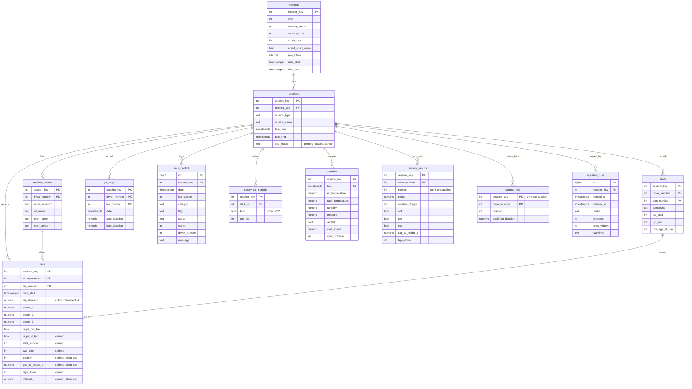

# Spike: what OpenF1 really returns (PW-4)

- **Date:** 22 November 2026
- **Race studied:** 2026 Singapore Grand Prix, 11 October 2026 (62 laps, 22 drivers)
- **Notebook:** [`notebooks/01-openf1-spike.ipynb`](../notebooks/01-openf1-spike.ipynb)
- **Decisions:** [ADR 3](adr/0003-openf1-is-the-session-data-source.md), [ADR 4](adr/0004-store-lap-level-data.md)

## 1. Questions

1. How is a race identified, and how do the endpoints join?
2. What does each endpoint return: rows, fields, types, null rates, quirks?
3. How many requests does a race cost under the free tier, and how does throttling behave?
4. Can FastF1 fill gaps in OpenF1, and which source owns which data?
5. What should the first database schema look like?

## 2. Identifying the race

| Key | Value | Found with |
| --- | --- | --- |
| `meeting_key` (race weekend) | 1296 | `GET /meetings?year=2026&country_name=Singapore` |
| Race `session_key` | 11388 | `GET /sessions?meeting_key=1296`, row with `session_name = "Race"` |
| Qualifying `session_key` | 11384 | same call, `session_name = "Qualifying"` |

- A **meeting** is a race weekend; a **session** is one practice, qualifying, sprint or race inside it.
  Every data endpoint takes `session_key`, and every row also carries `meeting_key`.
- Drivers are identified by `driver_number` within a session. Numbers can change between
  seasons, so a driver's name and team are stored per session, not globally.
- **All timestamps are UTC** (`+00:00`). `gmt_offset` on the meeting gives local time.
- `meeting_key=latest` and `session_key=latest` work, but a session counts as live from
  30 minutes before it starts until 30 minutes after it ends, and live data needs the paid
  tier. Ingestion must only load sessions that ended more than 30 minutes ago.

## 3. Endpoint findings

Rows are for the Singapore race. Null rates are only listed where they are not zero.

| Endpoint | Rows | Grain | Notable nulls | Quirks |
| --- | --- | --- | --- | --- |
| `drivers` | 22 | driver per session | `country_code` 100% | Name, acronym, team, team colour per session |
| `laps` | 1,240 | driver per lap | `lap_duration` 0.3%, `i1_speed` 24.5%, `st_speed` 20.6% | See 3.1 |
| `stints` | 47 | driver per stint | none | See 3.2 |
| `pit` | 25 | one per pit stop | none | See 3.2 |
| `race_control` | 155 | one per message | `driver_number` 53%, `flag` 39%, `sector` 88% | See 3.3 |
| `weather` | 160 | one per minute | none | `rainfall` is 0 or 1, not millimetres |
| `position` | 396 | one per position **change** | none | Not one row per lap |
| `intervals` | 28,131 | each driver every ~4.2 s | `gap_to_leader` 0.4% | See 3.4; about 4 MB per race |
| `session_result` | 22 | driver per session | `position` 14% (unclassified), `duration` 55% | `gap_to_leader` mixes numbers and strings |
| `starting_grid` | 22 | driver | quali `lap_duration` 4.5% | Lives under the **qualifying** `session_key`, not the race |
| `overtakes` | 191 | one per overtake | none | Overtaking and overtaken driver, position, time |
| `car_data`, `location` | — | ~4 Hz telemetry | — | Not used (ADR 4) |

### 3.1 Laps

- **Missing lap times are retirement laps.** All four laps without `lap_duration` are the lap a
  driver retired on (for example driver 5: last lap 8, classified with 7 laps).
  The loader keeps the row with a null time, and analysis must not treat it as a slow lap.
- **Lap 1 is different.** Every driver's lap 1 has the same `date_start` (the start signal),
  and lap 1 is about 10 s slower than a normal lap (109.7 s against a 99.2 s median).
  Strategy tools should exclude lap 1 from pace averages.
- **Pit-out laps are flagged, pit-in laps are not.** `is_pit_out_lap` is set on 25 laps,
  one per pit stop. The pit-in lap is the lap before; the loader should derive `is_pit_in_lap`.
  Pit-out laps are about 17 s slower than the median.
- Speed traps (`i1_speed`, `st_speed`) are missing on about a fifth of laps; treat them as optional.
- `segments_sector_*` are lists of mini-sector status codes; not needed for strategy.

### 3.2 Stints and pit stops

- Stints are numbered from 1 per driver, with no gaps or overlaps between `lap_end` and the
  next `lap_start`.
- For the four retired drivers, stints end one lap before their last `laps` row (the
  retirement lap). Joins from laps to stints must allow a lap with no stint.
- `compound` was always set (SOFT 25, MEDIUM 22 in this race). 9 stints started on used
  tyres (`tyre_age_at_start > 0`), so tyre age on a lap is
  `tyre_age_at_start + (lap_number - lap_start)`.
- Stint changes (25) match pit rows (25) exactly for every driver.
- `pit_duration` and `lane_duration` are identical in every row; `pit_duration` looks like an
  older name for the same value. `stop_duration` (2.1 to 7.4 s) is the stationary time and
  `lane_duration` (23.6 to 29.3 s) the whole pit lane. Store both under clear names.

### 3.3 Race control

- Categories: `Flag` 95, `Other` 54, `SafetyCar` 4, `SessionStatus` 2. Blue flags make up most
  flag messages.
- Safety car periods come from `category = "SafetyCar"`: here a VSC on laps 8 to 9 (the lap
  of driver 5's retirement) and another on laps 39 to 40. Each period is a "DEPLOYED" message
  followed by an "ENDING" one, both with `lap_number`. A derived `safety_car_periods` table
  makes strategy questions ("did he pit under the VSC?") easy.
- `driver_number` is a float with nulls (only set for driver-specific messages); cast to an
  integer on load.

### 3.4 Intervals and positions

- `gap_to_leader` holds three kinds of value: a number of seconds (82%), a string like
  `"+1 LAP"`, `"+2 LAPS"` or `"+3 LAPS"` for lapped cars (18%), and null (0.4%). Store it
  as two columns: `gap_to_leader_s` (number or null) and `laps_down` (integer).
- `intervals` and `position` are time series, not per-lap data. For strategy, the value at
  the end of each lap is enough, which turns 28,131 rows into about 1,240 (ADR 4).

## 4. Request budget

| Measure | Result |
| --- | --- |
| Requests for one race | 12: sessions, 10 race endpoints, starting grid |
| Time for one race | 6.4 s with the limiter; `intervals` is the slowest (about 1.3 s, 4 MB) |
| Data per race | About 4.8 MB of JSON, over 80% of it `intervals` |
| Full season | About 24 weekends × (race + qualifying + sprints) ≈ 350–400 requests ≈ 15 minutes at 28/min |
| Backfill 2023–2026 | About an hour |

**Throttling behaviour.** A client-side limit of exactly 3 per second still got HTTP 429
(the server's one-second window does not line up with ours). The 429 body is
`{"error":"Too Many Requests","detail":"Rate limit exceeded. Max 3 requests/second."}`
with a `Retry-After: 1` header. There are no rate-limit headers on successful responses,
so the client cannot see how close it is. **The ingestion client should limit itself to
2 per second and 28 per minute, and honour `Retry-After` on a 429.**

Other API behaviour: "no rows" is returned as **HTTP 404** with `{"detail":"No results found."}`,
not as an empty list. The client must map that 404 to an empty result.

## 5. OpenF1 vs FastF1, and who owns what

FastF1 could not load this race. Its timing data now comes from F1's live-timing archive,
which answered with HTTP 401, and FastF1 logs "Failed to authenticate with Formula 1 account"
and loads no laps, weather or race control. Using it would need a personal F1 account in
the pipeline, which breaks the project's rule of free sources without personal credentials.

| Data | Owner | Why |
| --- | --- | --- |
| Sessions from 2023: laps, stints, pits, weather, race control, positions, gaps, results, grid | **OpenF1** | Complete for the studied race, free, no key |
| Season calendar (when to ingest) | **Jolpica** | Full calendar with session times; free, no key |
| Results before 2023 | **Jolpica** | OpenF1 starts in 2023 |
| Anything from FastF1 | Not used | Needs an F1 account (ADR 3) |

## 6. Draft schema

Keys follow OpenF1 so upserts are simple. Derived columns are marked *(derived)*.

Notes:

- `starting_grid` is stored under the **race** `session_key`, mapped from the qualifying
  session of the same meeting, so every race table joins on one key.
- `overtakes` is left out at first: no planned tool needs it yet, and it is cheap to add later.
- Raw `intervals` and `position` rows are not stored; their values at each lap end are (ADR 4).

## 7. Open questions

- **Sprint weekends:** this was a normal weekend. Check that sprint sessions use the same
  endpoints and that `starting_grid` exists for sprint shootouts.
- **Red flags and full safety cars:** this race had only VSCs. Confirm the `SafetyCar`
  messages for a full safety car and how `SessionStatus` shows a red-flag suspension.
- **How soon data is complete:** this race was six weeks old. PW-5 should measure how many
  hours after a session the endpoints are complete, to set the retry window.
- **Calendar matching:** Jolpica lists 23 rounds for 2026 and OpenF1 25 race sessions
  (cancelled or relocated events, such as "Bahrain Grand Prix in Malaysia"). Meetings should be
  matched on date and country, not on name.
- **Wet races:** `rainfall` was 0 all race; check a wet race for compound values like
  INTERMEDIATE and WET.
